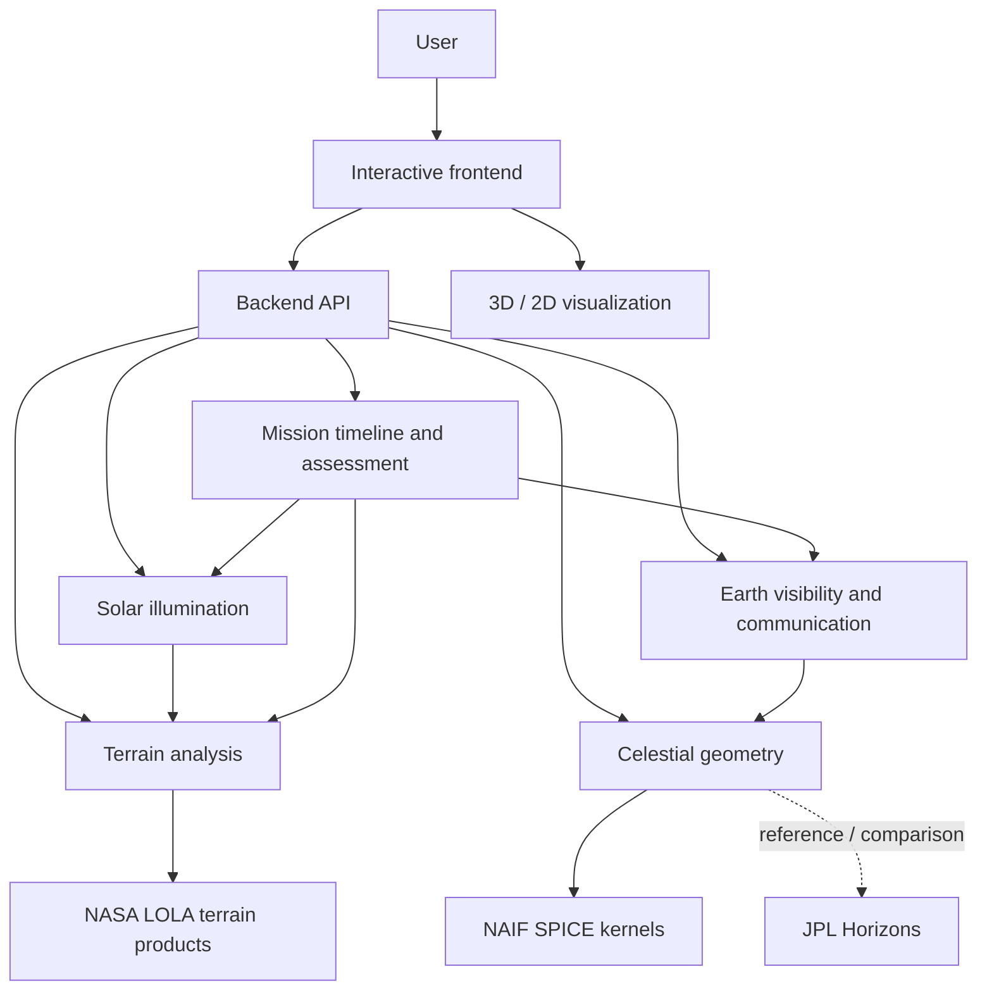

# System architecture

LUNA-SCOPE is organized as a web application with a Python scientific-analysis backend and an interactive frontend.

## High-level components

## Frontend

The frontend is implemented with React and TypeScript and uses interactive visualization components for lunar terrain, celestial geometry, solar analysis, Earth visibility, and mission-oriented views.

The source tree includes feature areas and services for:

- Lunar exploration and terrain inspection.
- Celestial observatory.
- Solar observatory.
- Earth observatory and communication.
- Mission timeline and mission assessment.
- Comparative terrain and workspace navigation.

The frontend calls backend APIs through typed service modules.

## Backend

The backend is implemented with Python and FastAPI. The documented scientific/API areas include:

- Terrain grid and terrain-derived analysis.
- Celestial geometry and ephemeris handling.
- Solar illumination and ray-based terrain-horizon analysis.
- Earth visibility and communication geometry.
- Mission timeline generation.
- Mission intelligence / decision assessment.

## Data and scientific computation

### Terrain

The terrain workflow uses NASA Lunar Orbiter Laser Altimeter (LOLA) products. The locally documented Site04 terrain bundle contains 5 m/pixel rasters over a 3,200 × 3,200 pixel region. Product details are listed in [DATA-SOURCES.md](../scientific-references/DATA-SOURCES.md).

### Celestial geometry

The ephemeris subsystem uses NASA/JPL NAIF SPICE through the Python ecosystem and kernel files for planetary and lunar reference data. JPL Horizons is used as a comparison/reference service in the validation workflow.

### Illumination and communication

Solar illumination analysis evaluates Sun geometry relative to a local observer and terrain horizon. Earth-visibility analysis evaluates Earth line-of-sight geometry and antenna elevation constraints. These are separate physical questions and are represented by separate backend analysis services.

## API surface

The latest verification notes in the project records identify API areas for terrain context/grid, celestial metadata/geometry, point illumination, point communication, mission timeline, and mission intelligence. For exact request and response schemas, use the API contracts in the [main source repository](https://github.com/VedShinkar/LUNA-SCOPE/tree/main/docs).

## Verification boundary

Build and test logs document backend route smoke tests, frontend build checks, and automated tests. These are not equivalent to a full human browser acceptance test. The current source repository is authoritative for the latest implementation state.
